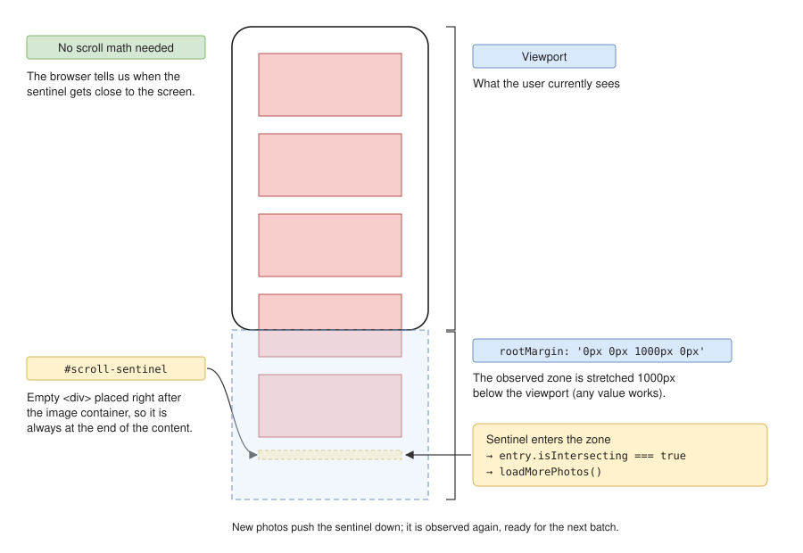
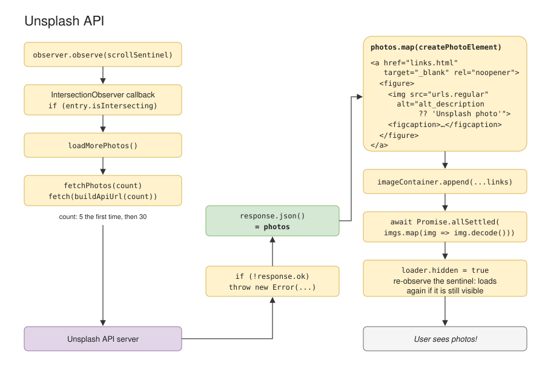

# Comment fonctionne `script.js`

Ce document décrit `script.js` dans l'ordre où les choses se passent réellement, plutôt que ligne par ligne.

## L'idée générale

La page n'a **aucune photo au départ**. Tout repose sur un élément invisible placé tout en bas de la page, `#scroll-sentinel` (la « sentinelle »). Le navigateur prévient le script quand cette sentinelle approche de l'écran, et le script répond : « il faut charger des photos ». Les nouvelles photos repoussent la sentinelle vers le bas, l'utilisateur fait défiler, la sentinelle réapparaît, et ainsi de suite. C'est ce qui rend le défilement infini.



## 1. La préparation (en haut du fichier)

```js
const imageContainer = document.getElementById('image-container');
const loader = document.getElementById('loader');
// …
```

Le script récupère une fois pour toutes les éléments HTML qu'il va manipuler : le conteneur des photos, l'animation de chargement, la sentinelle, le formulaire de recherche, etc.

```js
const INITIAL_COUNT = 5;
const NEXT_COUNT = 30;
```

Le premier chargement demande 5 photos, pour que la page s'affiche vite. Les suivants en demandent 30.

```js
let isLoading = false;   // un chargement est-il en cours ?
let isFirstLoad = true;  // est-ce le tout premier chargement ?
let query = '';          // le thème recherché ('' = photos au hasard)
let searchId = 0;        // numéro de la recherche en cours
```

Ces variables représentent l'**état** de la page et changent pendant son utilisation.

## 2. Le démarrage (tout en bas du fichier)

```js
const observer = new IntersectionObserver(
  ([entry]) => {
    if (entry.isIntersecting) loadMorePhotos();
  },
  { rootMargin: '0px 0px 1000px 0px' },
);

observer.observe(scrollSentinel);
```

C'est **le cœur du défilement infini**. On crée un « observateur » auquel on dit : « préviens-moi quand la sentinelle entre dans la zone visible, agrandie de 1000 px vers le bas ». Grâce à ces 1000 px, on charge la suite *avant* que l'utilisateur arrive au bas de la page, et il ne voit jamais de vide.

`observer.observe(...)` déclenche immédiatement une première vérification. Au chargement, la page est vide et la sentinelle est donc visible : `loadMorePhotos()` est appelée tout de suite. C'est ce qui affiche les premières photos.

## 3. `loadMorePhotos()` : la fonction principale



Elle se déroule en plusieurs étapes.

### a. Éviter les doublons

```js
if (isLoading) return;
isLoading = true;
```

Si un chargement est déjà en cours, on ne fait rien. Sinon, l'observateur pourrait lancer plusieurs requêtes à la fois.

### b. Demander les photos à Unsplash

```js
const photos = await fetchPhotos(isFirstLoad ? INITIAL_COUNT : NEXT_COUNT);
```

`await` veut dire « attends la réponse d'Unsplash avant de continuer », sans bloquer la page pendant ce temps. On demande 5 photos la première fois, 30 ensuite.

### c. Aucune photo trouvée

```js
if (photos.length === 0) {
  showStatus(`No photos found for “${query}”.`);
  return;
}
```

On affiche le message et on s'arrête. La sentinelle n'est pas réobservée, donc les chargements s'arrêtent aussi.

### d. Créer les éléments HTML et les ajouter à la page

```js
const elements = photos.map(createPhotoElement);
imageContainer.append(...elements.map(({ link }) => link));
```

Chaque photo reçue (des données JSON) est transformée en vrais éléments HTML, puis ajoutée en une seule fois dans le conteneur.

### e. Attendre que les images soient affichables

```js
await Promise.allSettled(elements.map(({ img }) => img.decode()));
loader.hidden = true;
```

`img.decode()` attend qu'une image soit téléchargée et prête à s'afficher. `Promise.allSettled` attend **toutes** les images, qu'elles réussissent ou échouent. Une image cassée ne bloque donc pas le reste. Ensuite, on cache l'animation de chargement.

### f. Relancer l'observation

```js
observer.unobserve(scrollSentinel);
observer.observe(scrollSentinel);
```

Sur un grand écran, 5 photos ne suffisent parfois pas à repousser la sentinelle hors de la zone. L'observateur ne prévient que lors d'un *changement* (la sentinelle entre ou sort), donc il ne dirait rien. En arrêtant puis en reprenant l'observation, on force une nouvelle vérification : si la sentinelle est encore visible, on recharge.

### g. Libérer le verrou

```js
finally { … isLoading = false; }
```

`finally` s'exécute toujours, succès ou erreur. On autorise ainsi le chargement suivant.

## 4. Les petites fonctions utilitaires

### `buildApiUrl(count)`

Construit l'adresse de la requête, par exemple :

```
https://api.unsplash.com/photos/random/?client_id=…&count=30&orientation=landscape&query=beach
```

`URLSearchParams` s'occupe d'encoder correctement les espaces et les accents. `orientation=landscape` demande uniquement des photos en format paysage. Le paramètre `query` n'est ajouté que si un thème est défini.

### `fetchPhotos(count)`

Envoie la requête et vérifie la réponse :

- un code **404** est la façon dont Unsplash dit « aucune photo pour ce thème », et on renvoie une liste vide ;
- toute autre erreur (`!response.ok`) devient une exception, gérée par le `catch` de `loadMorePhotos` ;
- sinon, on renvoie les photos décodées depuis le JSON.

### `createPhotoElement(photo)`

Fabrique ce bloc HTML pour une photo :

```html
<a href="lien vers la page Unsplash" target="_blank" rel="noopener">
  <figure>
    
    <figcaption>description</figcaption>
  </figure>
</a>
```

- `({ links, urls, alt_description })` est une *déstructuration* : on extrait directement ces trois champs de l'objet photo.
- `Object.assign(document.createElement('a'), { href: …, target: … })` crée l'élément et lui donne ses propriétés en une seule instruction.
- `alt_description ?? 'Unsplash photo'` utilise `??`, qui veut dire « si la valeur est `null` ou `undefined`, prends celle de droite ».

### `showStatus(message)`

Affiche un message (aucun résultat, erreur) sous les photos.

## 5. La recherche par thème

```js
searchForm.addEventListener('submit', (event) => {
  event.preventDefault();
  startSearch(searchInput.value.trim());
  searchInput.value = '';
});
```

Appuyer sur Entrée dans le champ « soumet » le formulaire. `preventDefault()` empêche le navigateur de recharger la page, ce qu'il fait par défaut avec un formulaire. On lance ensuite la recherche avec le texte tapé (`trim()` retire les espaces en trop) et on vide le champ.

`startSearch(newQuery)` remet tout à zéro pour le nouveau thème :

- enregistre le thème et met à jour le texte « Theme: … » ;
- vide le conteneur de photos (`replaceChildren()` sans argument supprime tous les enfants) ;
- réaffiche l'animation de chargement et remonte en haut de la page ;
- relance l'observation, ce qui déclenche le premier chargement du nouveau thème.

## 6. Le rôle de `searchId`

C'est la partie la plus subtile. Imagine que tu cherches « beach » et que, pendant que les photos arrivent, tu tapes « mountains ». La réponse « beach » arrive *après* que tu as changé de thème. Sans précaution, des plages apparaîtraient au milieu des montagnes.

La solution est un numéro de recherche :

- chaque `startSearch` incrémente `searchId` ;
- au début de `loadMorePhotos`, on mémorise le numéro en cours (`currentSearchId`) ;
- après chaque `await`, on vérifie `if (currentSearchId !== searchId) return;`. Si le numéro a changé entre-temps, ces photos sont périmées et on les ignore.

## Et `API_KEY` ?

Elle n'est pas définie dans `script.js`, mais dans `config.js`, qu'`index.html` charge juste avant. Les deux fichiers partagent le même espace global, donc `script.js` peut utiliser `API_KEY` directement.

En local, `config.js` est créé à la main à partir de `config.example.js`. Sur GitHub Pages, il est généré par le workflow à partir du secret `UNSPLASH_ACCESS_KEY`.

## Le parcours complet, résumé

1. La page s'ouvre et l'observateur voit la sentinelle.
2. `loadMorePhotos()` récupère 5 photos, les ajoute à la page et attend qu'elles s'affichent.
3. La sentinelle est encore visible ? On recharge (30 photos). Sinon, on attend.
4. L'utilisateur fait défiler, la sentinelle approche de l'écran, et on retourne à l'étape 2.
5. L'utilisateur tape un thème et appuie sur Entrée : tout est remis à zéro et on retourne à l'étape 2, avec le thème.
